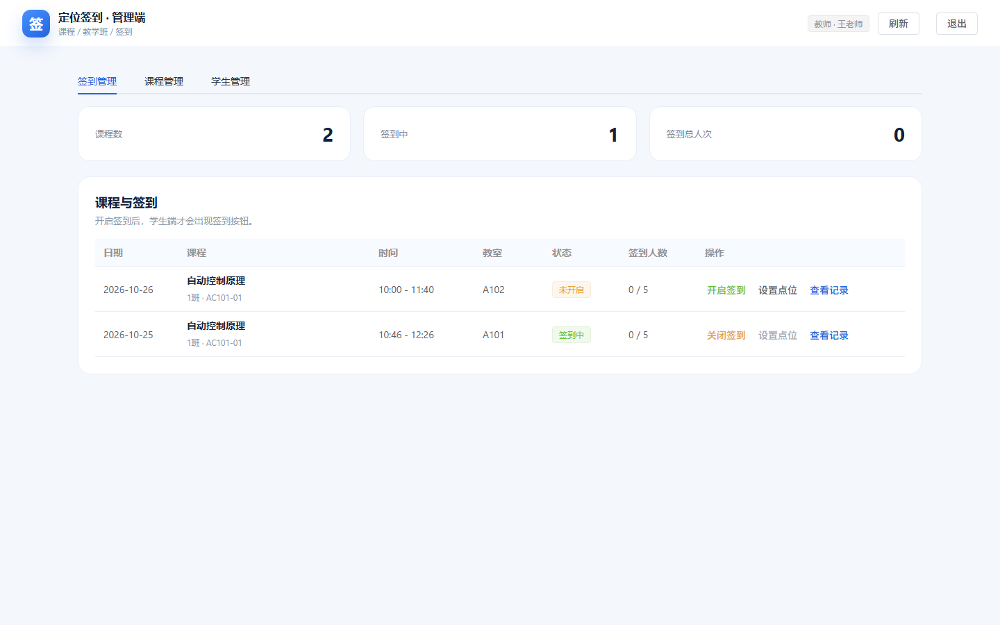
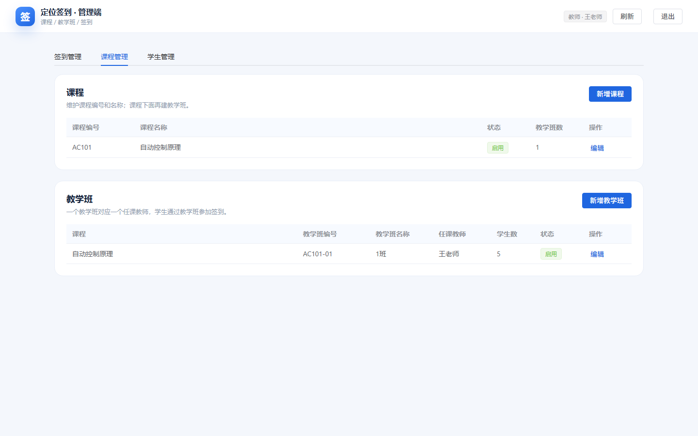
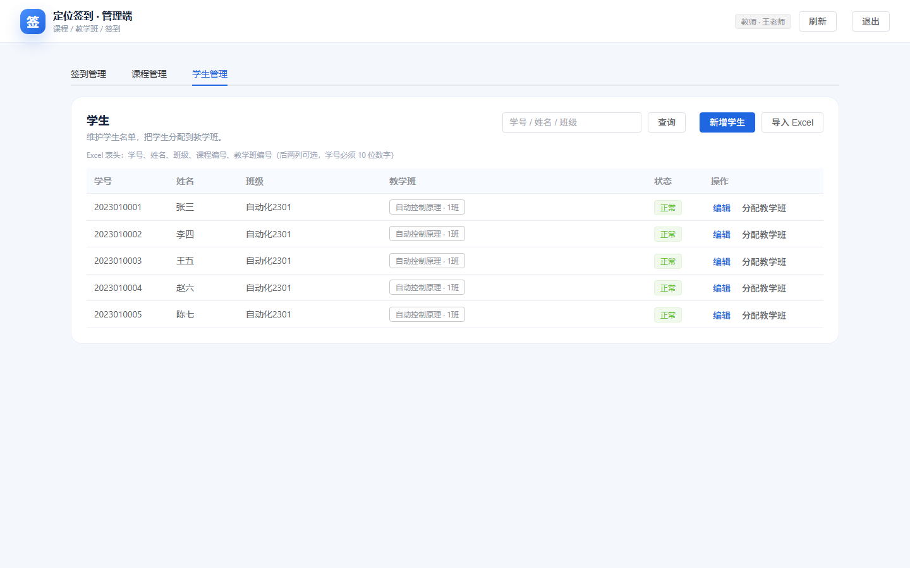

# 管理端（教师 / 管理员）

基于 **Vue 3 + Vite + Element Plus** 的 Web 管理端，当前聚焦最小闭环：

- 教师/管理员登录；
- 查看自己的课程 / 教学班 / 一次课；
- 设置签到点（经纬度、距离阈值）；
- 手动开启 / 关闭签到；
- 查看某次课的签到记录。

## 预览






## 运行

```bash
cd admin-web
npm install
npm run dev
```

默认端口：`http://localhost:5174`

也可以直接双击 `start-admin.bat`。

构建：

```bash
npm run build
```

产物在 `dist/`。也可以双击 `build-admin.bat`。

## 演示账号

| 角色 | 手机号 | 密码 |
|---|---|---|
| 教师 | 13800000001 | teacher123 |
| 管理员 | 13800000000 | admin123 |

教师只能管理 `course_sections.teacher_id` 指向自己的教学班；管理员可以管理全部。

## 后端地址

`src/api.js`：

```js
const BASE_URL = import.meta.env.VITE_API_BASE || ''
```

开发时通过 `vite.config.js` 的 `/api` 代理访问 `http://127.0.0.1:8000`，所以留空即可。

启动前先确认：

```text
server/start-mysql.bat      # MySQL 3307
server/run-backend.bat      # FastAPI 8000
```

## 当前功能

### 课程列表

读取 `GET /api/admin/class-sessions`，显示日期、课程、教学班、时间、教室、签到状态、签到人数/总人数。

### 新增一次课

- 选择教学班、上课日期、节次、时刻、教室；
- 创建后默认“未开启”；
- 再通过“设置点位”配置签到点，然后“开启签到”。

### 课程管理

- 课程：新增 / 编辑课程编号、名称、状态；
- 教学班：新增 / 编辑教学班编号、名称、任课教师、状态；
- 页面顶部“课程管理”标签进入。

### 开启 / 关闭签到

- 开启：`POST /api/admin/class-sessions/{id}/open`
  - 必须已设置签到点；
  - 课程不能是已取消状态。
- 关闭：`POST /api/admin/class-sessions/{id}/close`

### 设置签到点

- `PUT /api/admin/class-sessions/{id}/point`
- 签到开启后禁止修改，需先关闭；
- 支持“使用我的当前位置”自动填入浏览器定位。

### 学生管理

- 学生列表：学号、姓名、班级、教学班、状态；
- 新增 / 编辑学生；
- 分配教学班（课程 → 教学班）；
- Excel 批量导入。

Excel 表头：

```text
学号 | 姓名 | 班级 | 课程编号 | 教学班编号
```

后两列可选；学号必须 10 位数字。导入会返回新增 / 更新 / 分配 / 跳过 / 错误行。

### 签到记录

- `GET /api/admin/class-sessions/{id}/checkins`
- 显示学号、姓名、签到时间、距离、状态；
- 支持编辑学号/姓名快照；
- 支持逻辑删除 / 恢复；
- 支持导出 Excel。

## 说明

- 课程/教学班/学生已支持新增和编辑，暂未做物理删除，统一用 `status` 停用；
- 签到记录删除是逻辑删除，记录保留，学生不能重复签到；
- 种子数据包含今天的一次课（已开启）和明天的一次课（未开启），方便演示；
- 开发环境 CORS 允许所有来源；正式部署需要收紧。
