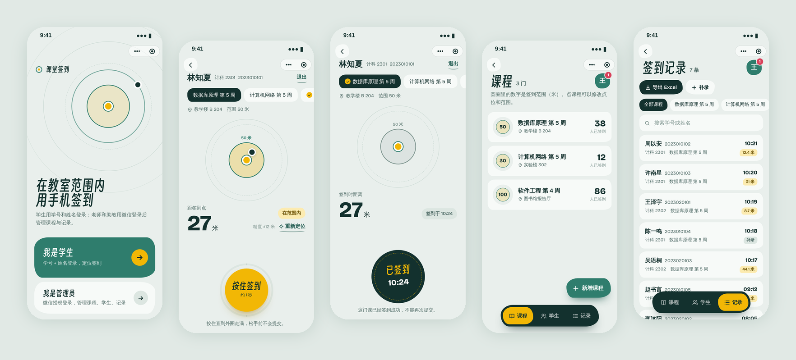

# 课堂签到 · 微信小程序定位签到系统

管理员和学生共用一个微信小程序，首页选择身份。管理员用微信授权登录，管理课程与签到点位、导入学生名单、查看和修改签到记录、导出 Excel；学生用学号 + 姓名登录，进入课程的签到范围后按住按钮签到。后端是微信云开发（云函数 + 云数据库 + 云存储）。



## 文档

| 交付物 | 位置 |
| --- | --- |
| **三份文档（PDF，可直接打开）** | [ER 图](docs/提交文档/01-ER图.pdf)　[数据库表结构](docs/提交文档/02-数据库表结构.pdf)　[交互原型](docs/提交文档/03-交互原型.pdf) |
| ER 图 | [docs/01-ER图.md](docs/01-ER图.md)（概念 ER 图、物理模型图、Mermaid 版） |
| 数据库表与字段 | [docs/02-数据库设计.md](docs/02-数据库设计.md)（4 个集合的字段、约束、索引、权限） |
| 交互原型 | [docs/03-交互原型.md](docs/03-交互原型.md)（全部界面、跳转流转图）；可点击原型 [docs/prototype/index.html](docs/prototype/index.html) |
| 学生名单模板 | [docs/学生名单模板.xlsx](docs/学生名单模板.xlsx) |

## 功能

**管理员**

- 微信授权登录：云函数从调用上下文取得当前微信的 OPENID 判断身份。系统里还没有管理员时，第一个登录的人自动成为管理员；之后的人提交申请，由已有管理员通过。
- 课程管理：新增、编辑、删除课程；每门课程设置**一个**签到点位（地图选点、用当前位置或直接点地图）和距离阈值（默认 50 米）。
- 学生管理：Excel 批量导入（班级、姓名、学号三列，列顺序不限，支持 .xlsx / .csv），按班级分组查看、搜索。
- 签到记录：按课程筛选、搜索；修改（更正学生、签到时间、备注）、删除、补录；导出 Excel。

**学生**

- 学号 + 姓名与名单匹配即可登录，不设密码，不绑定微信 openid。
- 进入签到页后持续定位（`wx.getLocation`，gcj02），实时显示与签到点的距离；超出阈值时按钮置灰。
- 在范围内按住按钮约 1 秒提交；成功后显示带时间的「已签到」印章。

## 业务约束如何保证

所有判定都在云函数 `api` 里完成，小程序端只展示结果；数据库对客户端不可读写，学生无法绕过。

| 约束 | 实现 |
| --- | --- |
| 超出阈值禁止签到 | 云函数用 Haversine 公式重新计算距离，`distance > radius` 拒绝 |
| 同一课程、同一设备 ID 只能签 1 次，无例外 | 签到记录主键 `_id = 课程ID_设备ID`，数据库保证唯一，并发重复提交也只有一条成功 |
| 签到成功后不可再次提交、不允许重试 | 同一课程同一学号已有记录（含已删除的）即拒绝 |
| 防止清缓存后代签 | 设备 ID 是首次打开时生成并持久保存的 UUID；另外比对同一微信 OPENID，清缓存换了设备 ID 也会被识别（OPENID 只记录，不用于学生登录） |
| 删除记录后不能重签 | 删除为软删除，记录仍占位；需要恢复时管理员「补录」 |
| 不支持多点位、无时间段、无迟到缺勤、无消息推送、无操作日志 | 按任务书边界，未实现这些功能 |

`cloudfunctions/api/test/` 里有 17 条业务规则测试（内存数据库），覆盖上面每一条。

## 目录结构

```
checkin-miniprogram/
├── miniprogram/                  小程序前端
│   ├── app.js / app.json / app.wxss
│   ├── config.js                 云开发环境 ID（一般留空）
│   ├── pages/
│   │   ├── index/                首页：选择身份
│   │   ├── student/login/        学生登录
│   │   ├── student/checkin/      学生签到
│   │   ├── admin/login/          管理员登录、申请、待审核
│   │   ├── admin/home/           管理端主页（课程 / 学生 / 记录 三个面板）
│   │   └── admin/course-edit/    新增 / 编辑课程
│   ├── components/
│   │   ├── radar/                签到范围图
│   │   ├── hold-button/          按住签到按钮
│   │   ├── course-pane/ student-pane/ record-pane/   管理端三个面板
│   │   └── nav-bar/ sheet/ toast/ ic/              导航栏、底部抽屉、提示、图标
│   ├── utils/                    api 调用、设备 ID、登录状态、距离计算、格式化
│   ├── styles/fonts.wxss         字体子集（自动生成）
│   └── assets/
├── cloudfunctions/api/           云函数（单入口，按 action 分发）
│   ├── index.js / router.js
│   ├── routes/                   admin / course / student / checkin / record
│   ├── lib/                      鉴权、校验、距离、Excel、数据库辅助
│   └── test/                     业务规则测试
├── docs/                         ER 图、数据库设计、交互原型、界面截图
├── scripts/                      生成 ER 图、字体子集、图标、原型、预览截图、静态检查
└── project.config.json
```

## 部署

需要：[微信开发者工具](https://developers.weixin.qq.com/miniprogram/dev/devtools/download.html)、一个已注册的小程序 AppID（云开发不能用测试号）。

1. **导入项目**：开发者工具 → 导入，选择本仓库根目录，填入你的 AppID（会写进 `project.config.json` 的 `appid`）。
2. **开通云开发**：工具栏点「云开发」→ 开通，创建一个环境。`miniprogram/config.js` 的 `envId` 留空即使用当前环境；有多个环境时填入要用的环境 ID。
3. **创建集合**：云开发控制台 → 数据库，新建 `admins`、`courses`、`students`、`checkins` 四个集合；每个集合的权限设为「自定义安全规则」：
   ```json
   { "read": false, "write": false }
   ```
   小程序端只通过云函数访问数据。索引按 [数据库设计 §5](docs/02-数据库设计.md#5-索引) 添加，其中 `checkins` 的 `courseId + studentNo` 设为唯一索引。
4. **部署云函数**：在 `cloudfunctions/api` 上右键 →「上传并部署：云端安装依赖」。依赖是 `wx-server-sdk` 和 `exceljs`。
5. **隐私与权限**（小程序管理后台）：
   - 开发管理 → 接口设置：申请开通 `wx.getLocation` 和 `wx.chooseLocation`（审核通过前，开发者工具和体验版里也可以调用）。
   - 设置 → 服务内容声明 → 用户隐私保护指引：勾选「位置信息」，用途填「判断是否在课程签到范围内」；勾选「选中的文件」，用途填「导入学生名单」。
   - `app.json` 已声明 `requiredPrivateInfos: ["getLocation", "chooseLocation"]`。
6. **开始使用**：
   1. 首页选「我是管理员」→ 微信授权登录，你会成为第一位管理员。
   2. 「学生」→ 导入名单（把 Excel 发到微信聊天里再选择；格式见 `docs/学生名单模板.xlsx`）。
   3. 「课程」→ 新增课程，选签到点位，设置距离阈值。
   4. 学生在首页选「我是学生」，用学号 + 姓名登录后签到。

**调试定位**：开发者工具的模拟器里，可以在「调试器 → Sensor」中修改模拟位置，测试范围内 / 外两种情况。

## 本地检查

```bash
# 云函数业务规则测试（17 条）
cd cloudfunctions/api && npm install && npm test

# 小程序静态检查：JS 语法、事件处理函数是否存在、组件文件是否齐全、标签是否闭合
node scripts/check_miniprogram.js
```

开发辅助脚本（都在 `scripts/`，不参与小程序运行）：

| 脚本 | 作用 |
| --- | --- |
| `build_er.py` | 生成 ER 图 SVG（`render_png.py` 转 PNG） |
| `build_fonts.py` | 扫描界面文案，生成字体子集 `miniprogram/styles/fonts.wxss`；改了文案后重新运行 |
| `build_icons.py` | 生成图标组件样式 `components/ic/ic.wxss` |
| `build_prototype.py` / `shoot_prototype.py` | 构建单文件交互原型并截图 |
| `preview/` | 在 Node 里运行真实页面代码、渲染 WXML/WXSS 并截图（`docs/screens/`） |

## 设计说明

签到范围画成同心圆：实线圆是距离阈值，黑点是自己，进入范围后圆变成黄色、按钮亮起。全局只用一种强调色（藤黄），只出现在「在范围内」和「已签到」这两个时刻。签到需要按住约 1 秒，外圈走满才提交，避免误触，也和「只能提交一次」的规则相称。

字体：标题用得意黑（Smiley Sans），数字用 Bricolage Grotesque，均以子集形式内联，两者都是 SIL Open Font License 1.1。中文正文跟随系统字体。

## 已知限制

- 小程序拿不到硬件序列号，设备 ID 是本机生成的 UUID。清除小程序缓存会生成新 ID，所以额外用微信 OPENID 识别同一部手机上的同一个微信号；同一部手机切换不同微信号并清缓存的情况无法区分。
- 定位来自手机，无法完全防止模拟定位软件。
- 室内 GPS 常有 10–30 米误差，阈值不宜设得太小。

## 许可

代码以 MIT 许可发布，见 [LICENSE](LICENSE)。字体文件遵循各自的 SIL Open Font License 1.1。
