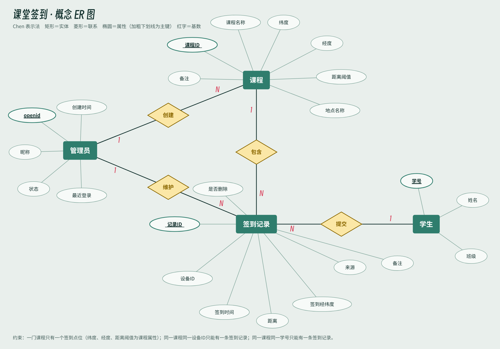
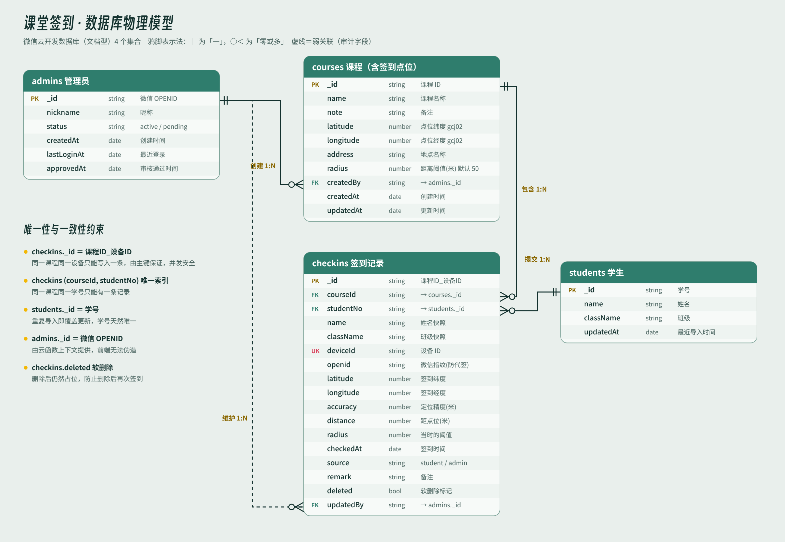
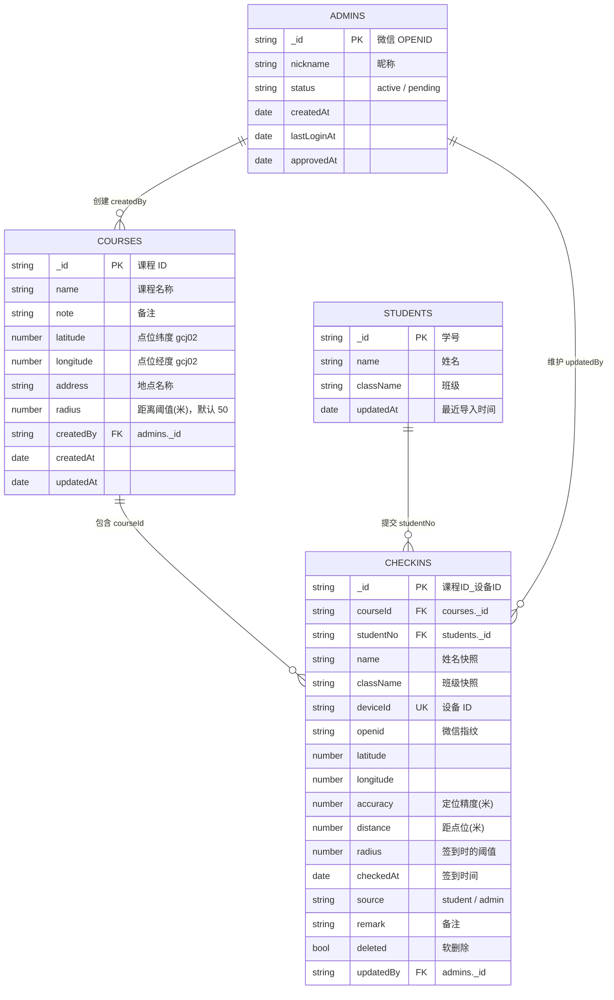

# 01 · ER 图

系统有 4 个实体：**管理员、课程、学生、签到记录**。签到记录是学生与课程之间多对多联系的落地实体，因为它自带大量属性（设备 ID、位置、距离、时间、来源），也需要被管理员单独增删改。

## 概念 ER 图（Chen 表示法）

| 联系 | 两端 | 基数 | 说明 |
| --- | --- | --- | --- |
| 创建 | 管理员 — 课程 | 1 : N | 一位管理员可以创建多门课程，每门课程有一个创建者 |
| 包含 | 课程 — 签到记录 | 1 : N | 一门课程有多条签到记录，每条记录属于一门课程 |
| 提交 | 学生 — 签到记录 | 1 : N | 一名学生可以在多门课程签到；**每门课程至多一条** |
| 维护 | 管理员 — 签到记录 | 1 : N | 管理员修改、删除、补录签到记录 |

签到点位没有单独建实体：业务明确「一门课程只有一个签到点位」，所以纬度、经度、距离阈值直接作为课程的属性。

## 物理模型（鸦脚表示法）

## Mermaid 版本

GitHub 会直接渲染下面的代码块，方便在线查看。

图的源文件在 `docs/er/*.svg`，由 `scripts/build_er.py` 生成，改字段后重新运行即可。
