# 03 · 交互原型

**可点击原型：** 用浏览器打开 [`prototype/index.html`](prototype/index.html)（单文件，离线也能打开）。左边的手机可以直接操作；签到页右侧的「模拟定位」滑块可以改变与签到点的距离，看按钮从灰色变成黄色。

下面是全部 19 个界面和它们之间的跳转条件。实线是主要路径，虚线是返回、分支或底部切换。

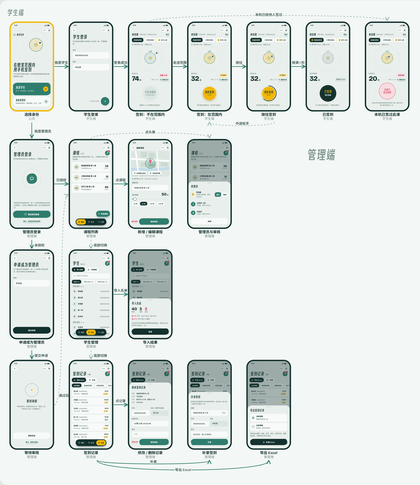

## 页面结构与跳转逻辑

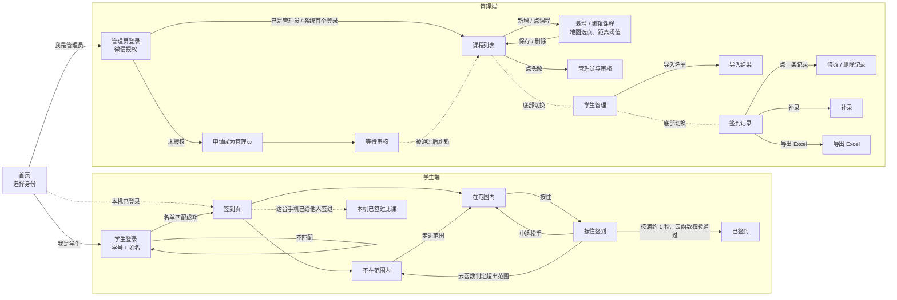

| 界面 | 进入方式 | 离开方式 | 关键规则 |
| --- | --- | --- | --- |
| 首页 | 打开小程序 | 我是学生 / 我是管理员 | 本机登录过的学生直接进签到页 |
| 学生登录 | 首页「我是学生」 | 匹配成功 → 签到页 | 学号 + 姓名与名单匹配；无密码、不绑定微信 |
| 签到页 | 登录成功 | 退出 → 首页 | 页面可见时每 5 秒定位一次；超出阈值按钮置灰 |
| 按住签到 | 在范围内按住按钮 | 走满 → 提交；松手 → 取消 | 提交前再定位一次；名单、距离、一机一次全部由云函数判定 |
| 已签到 | 提交成功 | — | 同一课程不能再次提交，不允许重试 |
| 本机已签过此课 | 这台手机已给其他学号签过 | — | 同一课程同一设备 ID 只能签 1 次，无例外 |
| 管理员登录 | 首页「我是管理员」 | 已是管理员 → 课程列表；否则 → 申请 | 云函数从调用上下文取 OPENID，前端无法伪造 |
| 课程列表 | 登录成功 | 底部切换、点课程、点头像 | 每门课程只有一个签到点位 |
| 新增 / 编辑课程 | 新增课程 / 点课程 | 保存、删除、返回 | 地图选点或用当前位置；阈值默认 50 米 |
| 学生管理 | 底部「学生」 | 导入名单 | Excel 需含班级、姓名、学号三列 |
| 签到记录 | 底部「记录」 | 修改、删除、补录、导出 | 删除为软删除，删除后该学生和该设备仍不能自助重签 |

## 小程序实际界面

以下截图由仓库里的真实小程序代码渲染（`scripts/preview/`：在 Node 里运行页面与组件的 JS，用模拟数据渲染 WXML + WXSS 后截图），与在微信开发者工具里看到的基本一致；地图位置用插画代替了原生 `<map>` 组件。

| 首页 | 学生登录 | 不在范围内 | 在范围内 | 已签到 |
| --- | --- | --- | --- | --- |
| 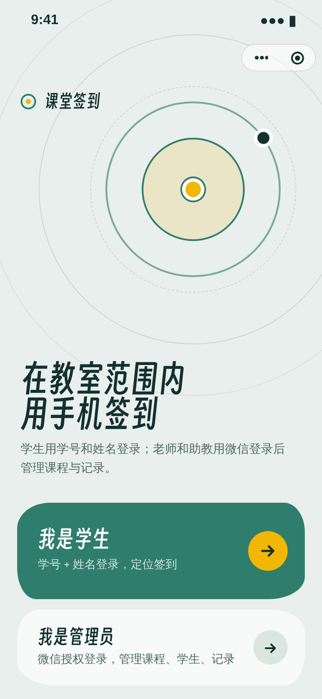 | 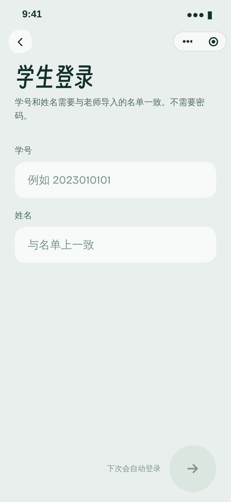 | 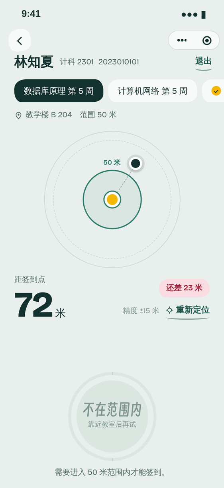 | 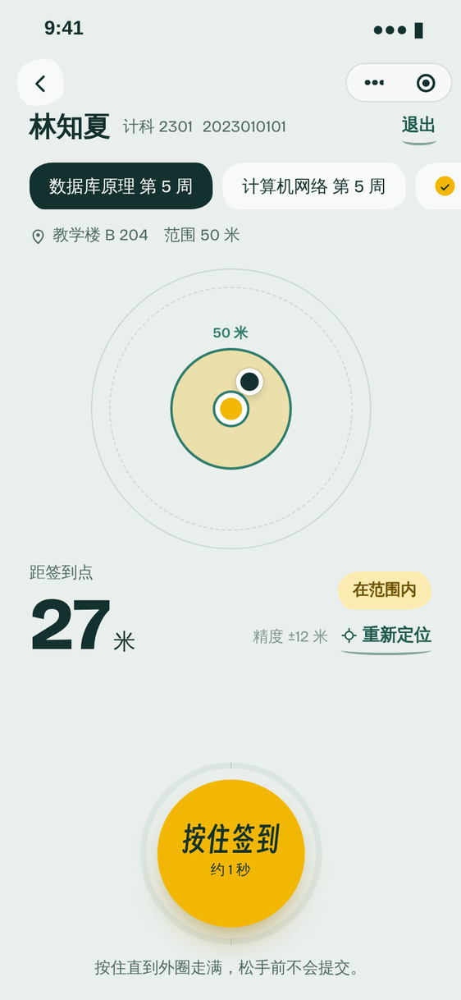 | 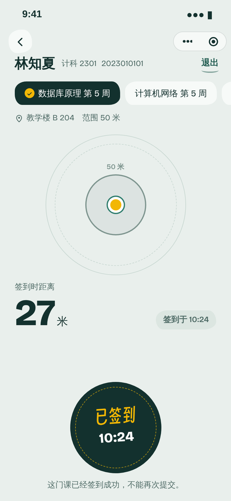 |

| 本机已签过 | 未授权定位 | 管理员登录 | 课程列表 | 编辑课程 |
| --- | --- | --- | --- | --- |
| 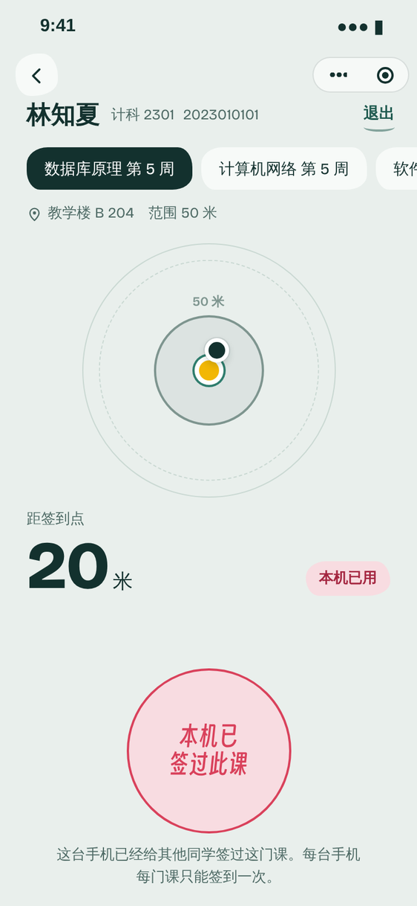 | 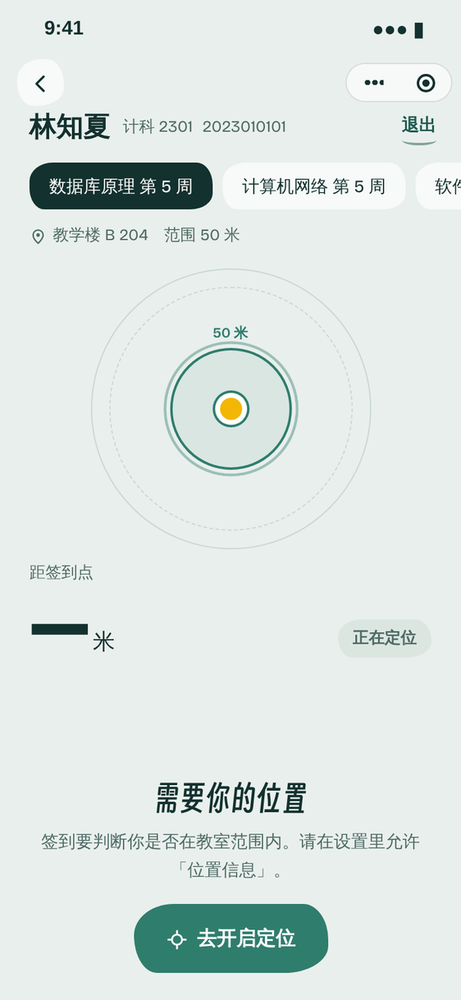 | 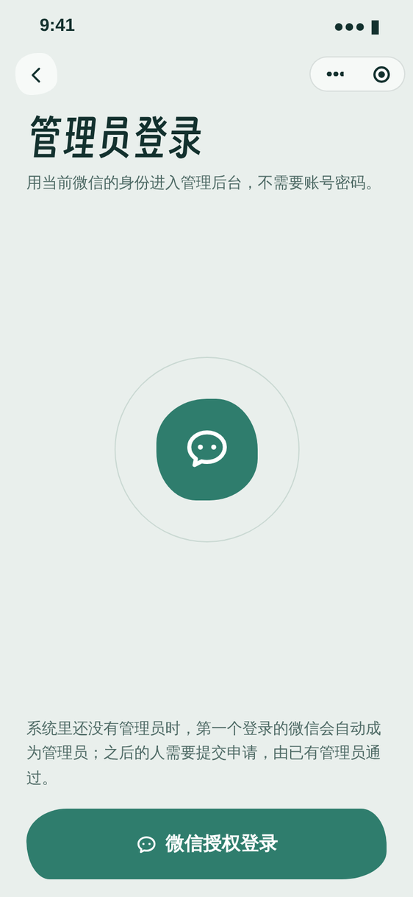 | 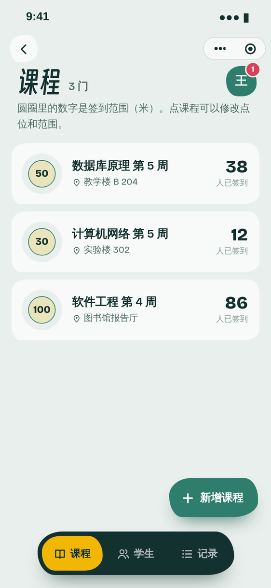 | 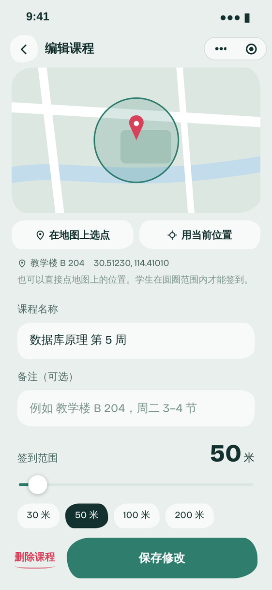 |

| 学生管理 | 导入结果 | 签到记录 | 修改记录 | 导出 Excel |
| --- | --- | --- | --- | --- |
| 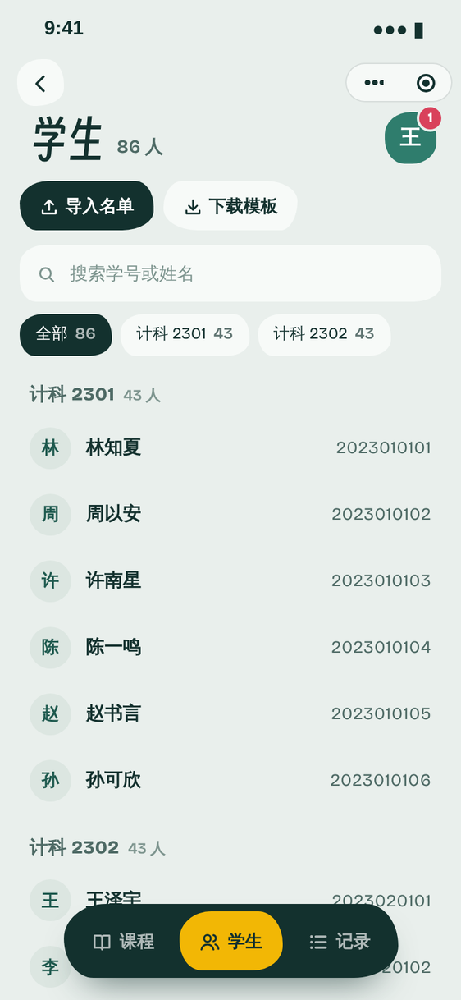 | 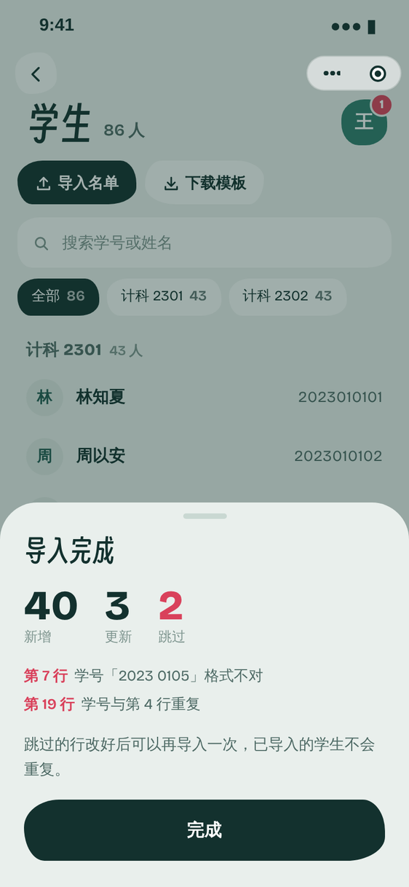 | 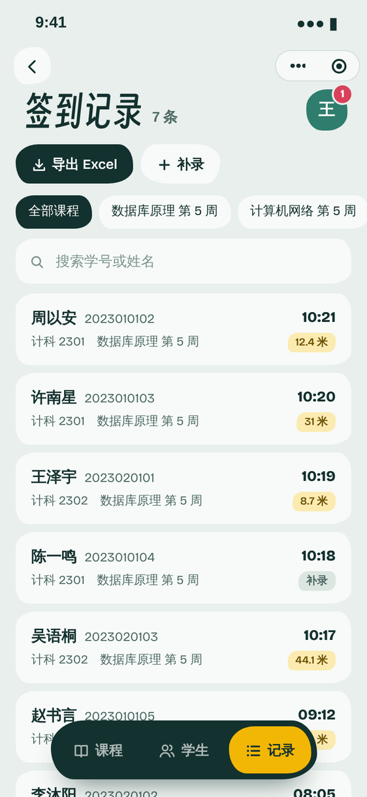 | 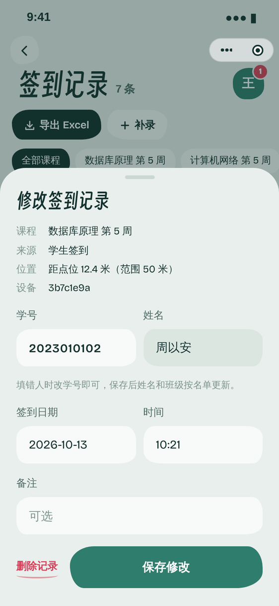 | 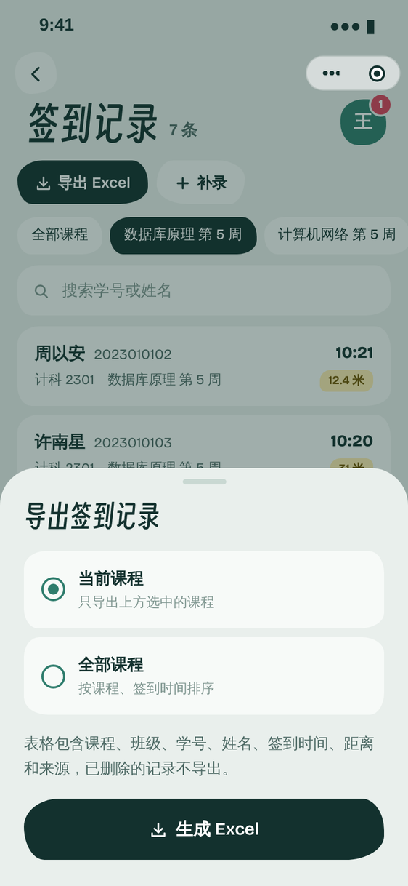 |

其余状态（删除确认、补录、申请与审核、小屏手机适配等）见 [`screens/`](screens/) 目录。
