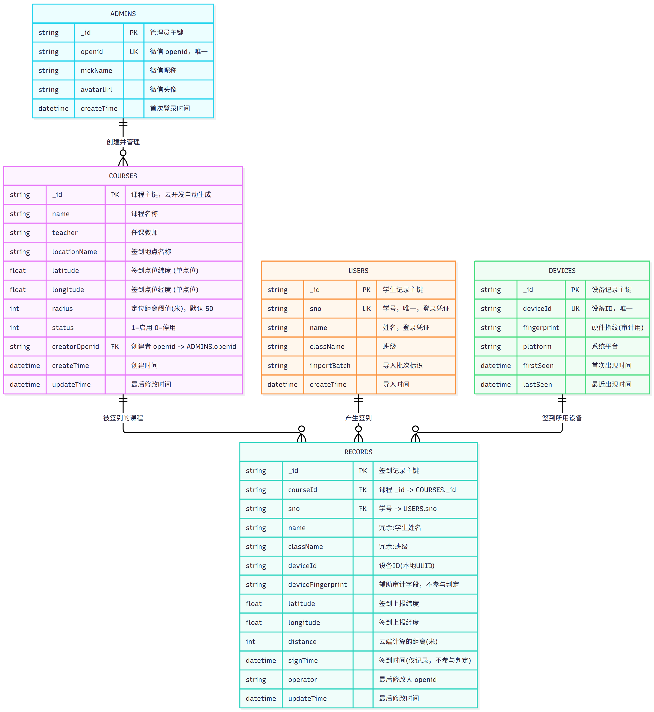
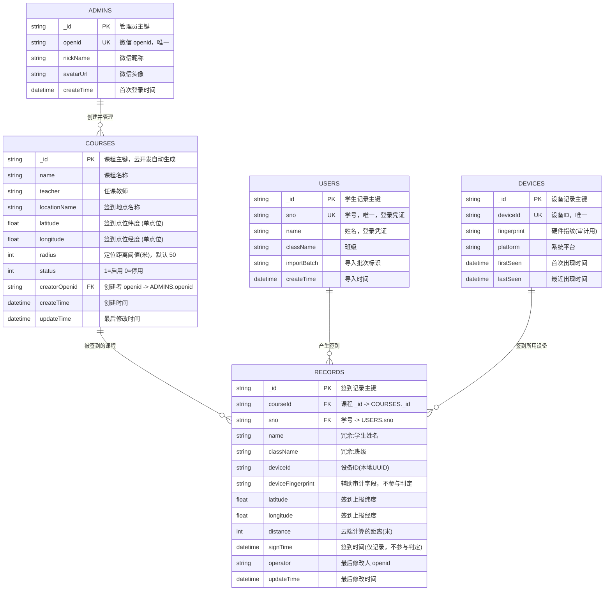

# ER 图 —— 微信小程序定位签到系统

## 零、图片版（推荐先看这个）



> **为什么有三种格式**：
> - **PNG**（本页上方）：位图，在 GitHub 网页上**能直接显示**，适合快速查看
> - **Markdown + Mermaid**（第二节）：源码形式，GitHub 会自动渲染成图，可编辑
> - **SVG**（`er-diagram.svg`）：矢量图，放大不失真，适合打印或插入文档
>
> ⚠️ **GitHub 出于安全考虑不渲染 `.svg` 文件**（点开会看到空白或只有下载按钮），这不是文件损坏。要看图请用本页的 PNG，或用 `er-diagram.md` 里的 Mermaid 代码块。

## 一、实体识别过程

从任务书的业务描述中提取名词，过滤掉非持久化的概念后得到实体。

| 来源描述 | 提取结果 | 是否建实体 | 说明 |
|---|---|---|---|
| 管理员管理课程、设置签到点位 | 课程 | ✅ `COURSES` | 需持久化点位、阈值 |
| Excel 批量导入学生名单（班级、姓名、学号） | 学生 | ✅ `USERS` | 需持久化名单用于登录校验 |
| 查看/修改/删除签到记录 | 签到记录 | ✅ `RECORDS` | 核心业务数据 |
| 管理员微信授权登录 | 管理员 | ✅ `ADMINS` | 需持久化 openid 白名单 |
| "靠小程序设备 ID 识别手机设备" | 设备 | ✅ `DEVICES`（可选） | 仅作审计记录，不参与判定 |
| 签到地点经纬度、距离阈值 | —— | ❌ | 是**课程的属性**，不是独立实体（不支持多点位） |
| 迟到 / 缺勤状态 | —— | ❌ | 任务书边界约束明确不做 |
| 签到时间段 | —— | ❌ | 任务书边界约束明确不做 |
| 操作日志 | —— | ❌ | 任务书边界约束明确不做 |

> 注意：任务书要求"不支持一门课程多个签到点位"。因此在模型中，经纬度是 `COURSES` 的**标量属性**，而**不是**独立的多值实体。这样设计使"多点位"在数据结构层面就无法表达。

## 二、ER 图



## 三、关系说明

| # | 关系 | 基数 | 参与约束 | 业务含义 |
|---|---|---|---|---|
| R1 | `ADMINS` → `COURSES` | 1 : N | 部分参与（课程必须有创建者；管理员可无课程） | 一个管理员可创建多门课程，一门课程只由一个管理员创建 |
| R2 | `COURSES` → `RECORDS` | 1 : N | 全参与（记录必须属于某课程） | 一门课程产生多条签到记录 |
| R3 | `USERS` → `RECORDS` | 1 : N | 部分参与（学生可从未签到） | 一个学生可产生多条记录（不同课程各一条） |
| R4 | `DEVICES` → `RECORDS` | 1 : N | 部分参与 | 一台设备可对多门课程各签到 1 次 |
| R5 | `COURSES` ↔ `DEVICES` | **M : N（约束为 1:1）** | —— | **核心业务约束**：同一课程 + 同一设备最多 1 条记录，由 `records` 上的复合唯一索引强制 |

### R5 的特别说明

任务书要求"同一课程，同一个设备 ID 只能签到 1 次，**无例外**"。这一约束的载体是：

```
records 集合上的复合唯一索引：courseId (asc) + deviceId (asc)，unique
```

它在 ER 语义上把 `COURSES` 与 `DEVICES` 之间本应是 M:N 的联系**限制为每对组合至多出现一次**。这不是应用层的 if 判断，而是数据库级别的结构约束，可抵御并发请求。

### 关于 `USERS` 与 `COURSES` 之间没有直接联系

二者之间不存在"选课"联系实体，原因见 [`design-decisions.md` D8](./design-decisions.md#d8--学生与课程的关联方式)：任务书未要求任何选课/排课功能，学生登录依据的是**全量名单**而非某门课的名单。二者仅通过 `RECORDS` 发生间接关联。

## 四、主键与外键约定

- **主键**：统一使用云开发自动生成的 `_id` 字符串，不复用业务字段作主键（学号可能因录入错误而变更）。
- **唯一键（UK）**：`USERS.sno`、`ADMINS.openid`、`DEVICES.deviceId` 各自建唯一索引。
- **外键（FK）**：云开发数据库**不支持外键约束**，参照完整性由云函数在写入前校验。ER 图上的 FK 标注表示**逻辑外键**。
- **冗余字段**：`RECORDS.name`、`RECORDS.className` 是从 `USERS` 冗余而来的快照。这是有意为之——导出 Excel 时需要姓名班级，而云开发不支持 `JOIN`，冗余可避免列表查询时逐条回查。代价是学生姓名变更后历史记录不同步，这对签到场景是可接受的（记录的是"签到当时"的信息）。

## 五、完整字段规范

字段的类型、必填、默认值、约束与示例见 → [`database-design.md`](./database-design.md)
