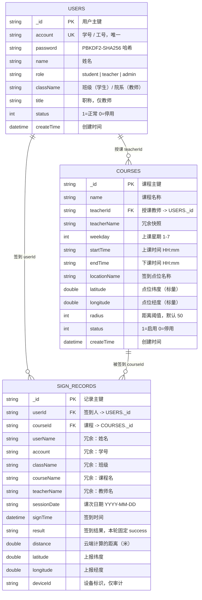

# ER 图 · 课程签到（v2 · 三张表）

> 本轮要求「先做好三张表」。下面这张图里只有三个实体：用户、课程、签到记录。
> 教师、管理员都不是独立实体，而是**用户的一个角色**；设备、课次也不建表，
> 分别作为字段存在于签到记录中。

---

## 一、ER 图



> 静态图片版见 `er-diagram.svg`（浏览器直接打开）。GitHub 上 Mermaid 代码块会自动渲染成图。

---

## 二、为什么只有三个实体

| 候选实体 | 是否建表 | 理由 |
|---|---|---|
| 用户 | ✅ `USERS` | 学生、教师、管理员共用一套身份，靠 `role` 区分 |
| 课程 | ✅ `COURSES` | 承载课程名、时间、点位、阈值 |
| 签到记录 | ✅ `SIGN_RECORDS` | 核心业务数据，连接用户与课程 |
| 教师 | ❌ | 课上明确「教师是用户角色，不单独建表」。建独立教师表会导致同一人两套身份 |
| 管理员 | ❌ | 同上，`role = 'admin'` |
| 设备 | ❌ | 去重依据是「用户 + 课程 + 课次」，设备只作为审计字段留在记录里 |
| 课次 | ❌ | 课程表存「星期几 + 起止时间」表达周课表；每次上课用 `sessionDate` 区分，不额外建表 |
| 签到点位 | ❌ | 一门课只有一个点位，是课程的**标量属性**，结构上无法表达多点位 |

---

## 三、关系说明

| # | 关系 | 基数 | 参与约束 | 业务含义 |
|---|---|---|---|---|
| R1 | `USERS` → `COURSES` | 1 : N | 部分参与（只有 `role=teacher` 的用户才有课；课程必须有教师） | 一位教师可教多门课，一门课只由一位教师教 |
| R2 | `USERS` → `SIGN_RECORDS` | 1 : N | 部分参与（学生可能一次没签） | 一个学生可有多条签到记录 |
| R3 | `COURSES` → `SIGN_RECORDS` | 1 : N | 全参与（记录必须属于某门课） | 一门课产生多条记录 |
| R4 | `USERS` ↔ `COURSES` | **M : N，约束为每课次 1 : 1** | —— | **核心业务约束**：同一个人、同一门课、同一个课次，最多一条记录 |

### R4 的载体

```
sign_records 上的复合唯一索引：userId + courseId + sessionDate，unique
```

这不是应用层的 `if` 判断，而是数据库级别的结构约束。并发两次请求时，
即使两次「先查后写」都通过了检查，第二次插入也会被数据库原子性地拒绝。

### 为什么去重键要带 `sessionDate`

如果只用 `userId + courseId`，学生第一周签过之后，这门课**整个学期都签不了了** ——
因为课程表里一条记录代表「每周重复的这门课」。加上课次日期后：

- 同一节课：`(张三, 自动控制原理, 2026-10-21)` 只能有一条 ✅
- 下一周：`(张三, 自动控制原理, 2026-10-28)` 是新的一节，可以再签 ✅

这仍然只用三张表，没有引入第四张「课次表」。

---

## 四、主键、外键与冗余

- **主键**：统一用 uniCloud 自动生成的 `_id`，不复用学号/工号（学号可能录错后修改）。
- **唯一键**：`users.account`（学号/工号）、`sign_records.(userId, courseId, sessionDate)`。
- **外键**：uniCloud 是文档型数据库，**不支持外键约束**。图中的 FK 是逻辑外键，由云函数在写入前校验。
- **冗余字段**：`sign_records` 里的 `userName / account / className / courseName / teacherName`
  是从 `users`、`courses` 复制过来的快照。原因：
  1. 文档数据库没有 `JOIN`，列表与导出需要这些字段；
  2. 学生改名、课程删除后，历史记录仍应保留**签到当时**的信息。

---

## 五、字段级定义

完整的类型、必填、默认值、约束、示例值，以及索引清单与权限配置，见
[`database-design.md`](./database-design.md)。
