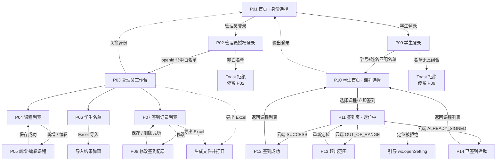

# 页面跳转流转逻辑

> 本文描述定位签到系统的完整页面流转规则：每个界面的进入条件、触发动作、目标页面与**失败分支**。
> 可视化版本见同目录 [`screens.html`](./screens.html) 底部「页面跳转流转逻辑」章节。

## 一、页面清单与路径映射

| 屏号 | 界面名称 | 小程序页面路径 | 访问角色 | 进入前提 |
|---|---|---|---|---|
| P01 | 首页 · 身份选择 | `pages/index/index` | 全部 | 小程序启动页 |
| P02 | 管理员授权登录 | `pages/admin/login/login` | 管理员 | 从 P01 选择"管理员登录" |
| P03 | 管理员工作台 | `pages/admin/home/home` | 管理员 | 管理员鉴权通过 |
| P04 | 课程列表 | `pages/admin/course/list/list` | 管理员 | 从 P03 进入 |
| P05 | 新增 / 编辑课程 | `pages/admin/course/edit/edit` | 管理员 | 从 P04 进入 |
| P06 | 学生名单 | `pages/admin/student/list/list` | 管理员 | 从 P03 进入 |
| P07 | 签到记录列表 | `pages/admin/record/list/list` | 管理员 | 从 P03 / P03 导出入口进入 |
| P08 | 修改签到记录 | `pages/admin/record/edit/edit` | 管理员 | 从 P07 点击"修改" |
| P09 | 学生登录 | `pages/student/login/login` | 学生 | 从 P01 选择"学生登录" |
| P10 | 学生首页 · 课程选择 | `pages/student/home/home` | 学生 | 学生登录成功 |
| P11 | 签到页 · 定位中 | `pages/student/signin/signin` | 学生 | 从 P10 选择课程 |
| P12 | 签到成功 | `pages/student/signin/result` | 学生 | 云端返回 `SUCCESS` |
| P13 | 签到页 · 超出范围 | `pages/student/signin/signin`（状态分支） | 学生 | 云端返回 `OUT_OF_RANGE` |
| P14 | 签到页 · 已签到 | `pages/student/signin/signin`（状态分支） | 学生 | 云端返回 `ALREADY_SIGNED` |

> P11、P13、P14 共用同一个页面文件，通过页面内部的状态机切换视图，避免为每种结果单独建页导致返回栈混乱。

## 二、总体流转图

## 三、逐屏跳转规则表

| 屏号 | 界面 | 触发动作 | 目标 | 失败分支 |
|---|---|---|---|---|
| P01 | 首页 · 身份选择 | 点击「管理员登录」 | P02 | — |
| P01 | 首页 · 身份选择 | 点击「学生登录」 | P09 | — |
| P02 | 管理员授权登录 | 点击「微信授权登录」 | P03 | openid 不在白名单 → Toast「当前微信账号不是管理员」并**停留 P02** |
| P02 | 管理员授权登录 | 点击返回 | P01 | — |
| P03 | 管理工作台 | 点击「课程管理」 | P04 | — |
| P03 | 管理工作台 | 点击「学生名单」 | P06 | — |
| P03 | 管理工作台 | 点击「签到记录」 | P07 | — |
| P03 | 管理工作台 | 点击「导出签到 Excel」 | 停留本页，生成后打开文档 | 无记录 → Toast「暂无签到记录可导出」；生成失败 → Toast 错误原因 |
| P03 | 管理工作台 | 点击「切换身份」 | P01 | 清除管理员登录态 |
| P04 | 课程列表 | 点击「＋新增课程」 | P05（新增模式） | — |
| P04 | 课程列表 | 点击行内「编辑」 | P05（回填模式） | — |
| P04 | 课程列表 | 点击「停用 / 启用」 | 停留本页，刷新状态 | — |
| P04 | 课程列表 | 点击「删除」 | 停留本页，移除该项 | 弹窗二次确认；删除后关联记录保留（由管理员自行处理） |
| P05 | 课程编辑 | 点击地图区域 | 调用 `wx.chooseLocation` 后回填经纬度 | 用户取消 → 保持原值 |
| P05 | 课程编辑 | 点击「保存」 | 返回 P04 并刷新列表 | 课程名为空 / 未选点位 / 阈值非法 → Toast 校验提示 |
| P06 | 学生名单 | 点击右上「⇪」 | 调用 `wx.chooseMessageFile` | 用户取消 → 无变化；文件非 .xlsx/.xls → Toast「请选择 Excel 文件」 |
| P06 | 学生名单 | 文件选定并上传完成 | 弹出导入结果（总数 / 成功 / 失败明细） | 表头缺失 → Toast「Excel 缺少班级/姓名/学号列」；全部失败 → 弹窗展示前 10 条原因 |
| P06 | 学生名单 | 点击「删除」 | 停留本页，移除该行 | 弹窗二次确认 |
| P06 | 学生名单 | 搜索框输入 / 上拉到底 | 本页刷新列表 | `users` 为空 → 提示「管理员尚未导入学生名单」 |
| P07 | 签到记录列表 | 点击行内「修改」 | P08 | — |
| P07 | 签到记录列表 | 点击行内「删除」 | 停留本页，移除该条 | 弹窗二次确认 |
| P07 | 签到记录列表 | 点击「导出 Excel」 | 停留本页，生成后打开文档 | 同 P03 导出失败分支 |
| P07 | 签到记录列表 | 切换筛选 / 上拉到底 | 本页加载下一页 | 无更多数据 → 提示「没有更多了」 |
| P08 | 修改签到记录 | 点击「保存修改」 | 返回 P07 并刷新 | 改课程后与既有记录冲突 → Toast「目标课程下该设备已有签到记录」并**停留 P08** |
| P08 | 修改签到记录 | 点击「删除该记录」 | 返回 P07 并刷新 | 弹窗二次确认 |
| P09 | 学生登录 | 点击「登录」 | P10 | 学号或姓名为空 → Toast 校验；名单无此组合 → Toast「学号与姓名不匹配，请核对后重试」；名单为空 → Toast「管理员尚未导入学生名单」 |
| P10 | 学生首页 | 点击课程「立即签到」 | P11 | 无启用课程 → 空状态「暂无进行中的签到课程」 |
| P10 | 学生首页 | 点击「退出登录」 | P01 | 弹窗二次确认，清除学号姓名缓存但**保留设备 ID** |
| P11 | 签到页 | 进入页面（自动） | 调用 `wx.getLocation` | 用户拒绝授权 → 弹窗引导「去设置」调用 `wx.openSetting`；定位服务未开 → Toast「请开启手机定位服务」；定位超时 → Toast「定位失败，请重试」 |
| P11 | 签到页 | 定位成功（自动） | 调用云函数 `signIn` 裁决 | 网络异常 → Toast「网络异常，请稍后重试」，**不产生签到记录** |
| P11 | 签到页 | 云端返回 `SUCCESS` | P12 | — |
| P11 | 签到页 | 云端返回 `OUT_OF_RANGE` | P13 | — |
| P11 | 签到页 | 云端返回 `ALREADY_SIGNED` | P14 | — |
| P11 | 签到页 | 云端返回 `NO_COURSE` | Toast 后返回 P10 | — |
| P13 | 超出范围 | 点击「重新定位」 | 回到 P11 重新定位 | 仍超出 → 继续停留 P13（**不限次数**，因未产生记录） |
| P12 / P14 | 结果页 | 点击「返回课程列表」 | 返回 P10 并刷新已签到状态 | — |

## 四、云端返回码与界面映射

学生签到云函数 `signIn` 的返回码决定了前端展示哪一个界面分支。**只有 `SUCCESS` 会写入签到记录**，其余分支一律不写入。

| 返回码 | 含义 | 对应界面 | 是否写入记录 |
|---|---|---|---|
| `SUCCESS` | 签到成功 | P12 | ✅ 写入 |
| `OUT_OF_RANGE` | 超出距离阈值 | P13 | ❌ 不写入 |
| `ALREADY_SIGNED` | 该设备已签到过此课程 | P14 | ❌ 不写入 |
| `NO_COURSE` | 课程不存在或已停用 | Toast 后返回 P10 | ❌ 不写入 |
| `INVALID_PARAM` | 经纬度非法 | Toast 提示 | ❌ 不写入 |
| `LOCATION_DENIED` | 未获得定位授权 | 引导 `wx.openSetting` | ❌ 不写入 |
| `NOT_STUDENT` | 学号姓名与名单不匹配 | Toast 后返回 P09 | ❌ 不写入 |
| `SYS_ERROR` | 服务端异常 | Toast「服务异常，请稍后重试」 | ❌ 不写入 |

## 五、需要特别说明的交互约束

1. **超范围允许反复重试**
   只有 `OUT_OF_RANGE` 分支允许学生不断重新定位。原因是此时**尚未产生任何签到记录**，重试不违反"不可重复签到"。若在此处也做次数限制，反而会因为定位误差（室内常见 30～100 米漂移）导致学生无法签到。

2. **已签到不提供任何重试入口**
   P14 页面只有"返回课程列表"，没有"重新签到"按钮。即便学生通过返回上一步、杀进程重进、或直接再次选择课程，云端仍会返回 `ALREADY_SIGNED`。

3. **设备 ID 与登录状态相互独立**
   退出登录只清除学号姓名缓存，**不清除设备 ID**。若两者一起清除，学生就能通过"退出再登录"重置设备标识，从而绕过签到次数限制。

4. **签到按钮防重复点击**
   P11 在定位与请求发出后立即置为禁用态并加锁，避免用户连点产生并发请求。后端复合唯一索引是最终保障。

5. **列表与表单不出现时间相关字段**
   界面中没有任何"签到开始/结束时间""迟到""缺勤"的展示位。签到时间仅在结果页与记录管理中作为**已发生的事实**展示，不参与任何准入判定。

6. **不存在消息推送相关界面**
   无订阅消息授权弹窗、无通知设置项。

7. **管理员端的修改权限边界**
   管理员可以修改签到记录的课程、学号、姓名、班级，但**不能修改签到采集数据**（时间、距离、经纬度、设备 ID）。这保证了原始签到事实不可被篡改，同时满足"支持修改签到记录"的需求。

## 六、页面栈与返回策略

小程序页面栈最多 10 层，本设计的跳转策略：

| 场景 | 跳转方式 | 理由 |
|---|---|---|
| P01 → P02 / P09 | `navigateTo` | 保留返回首页的能力 |
| P02 → P03（登录成功） | `redirectTo` | **不保留**登录页，防止返回后留在登录态判定页 |
| P03 → P04 / P06 / P07 | `navigateTo` | 保留返回工作台 |
| P04 ↔ P05 | `navigateTo` / `navigateBack` | 保存后返回并刷新列表 |
| P07 → P08 | `navigateTo` | 保存后返回并刷新列表 |
| P10 → P11 | `navigateTo` | 保留返回课程列表 |
| P11 → P12 | `redirectTo` | **不保留**签到页，防止学生返回后重复提交 |
| P09 → P10（登录成功） | `redirectTo` | 不保留登录页 |
| P10 → P01（退出登录） | `reLaunch` | 清空整个页面栈 |

## 七、与任务书条目的对应关系

| 任务书要求 | 原型落点 |
|---|---|
| 首页选择身份入口，管理员学生共用一套小程序 | P01 |
| 管理员：小程序内微信授权登录 | P02 |
| 管理员：新增课程，设置单个签到点位与自定义阈值（默认 50 米） | P05 |
| 管理员：Excel 批量导入学生名单（班级、姓名、学号） | P06 |
| 管理员：查看学生列表 | P06 |
| 管理员：查看全部签到记录，支持修改、删除 | P07、P08 |
| 管理员：导出签到记录为 Excel 文件 | P03 / P07 导出入口 |
| 学生：输入学号 + 姓名，与名单匹配即可登录，无密码，不绑定 openid | P09 |
| 学生：登录成功后调用微信原生位置 API | P11 |
| 学生：超出阈值禁止签到 | P13 |
| 学生：同一课程同一设备只能签到 1 次，签到后不可再次提交 | P12、P14 |
| 边界：不支持多点位 / 无时间段 / 无迟到缺勤 / 无消息推送 / 无操作日志 | 所有界面均无对应字段与入口 |
