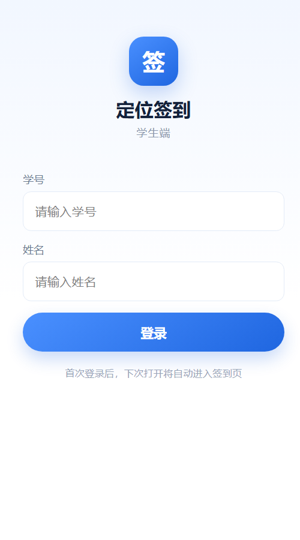
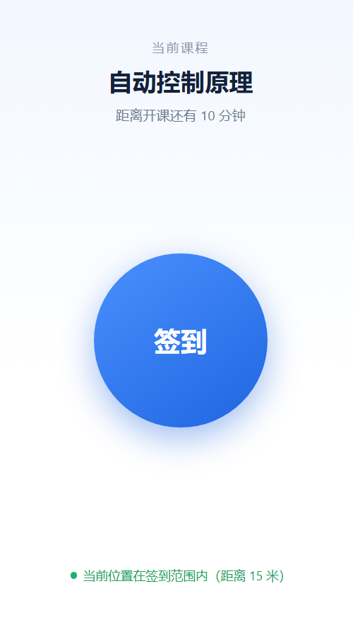

# 用户端（学生签到）

基于 **uni-app + Vue 3 + Vite** 的学生端，目标是一屏完成“当前课程 → 签到 → 结果反馈”。

## 页面

| 页面 | 路径 | 说明 |
|---|---|---|
| 签到页 | `src/pages/checkin/checkin.vue` | 当前课程、倒计时、大按钮、定位距离、结果反馈 |
| 登录页 | `src/pages/login/login.vue` | 学号 + 姓名一次性登录 |

登录后 token 存在本地，下次打开直接进入签到页。

## 预览




## 运行

```bash
cd user-app
npm install
npm run dev:h5
```

浏览器打开终端提示的地址（默认 `http://localhost:5173`）。

也可以直接双击 `start-h5.bat`。

构建 H5：

```bash
npm run build:h5
```

产物在 `dist/build/h5`。也可以双击 `build-h5.bat`。

构建微信小程序（后续）：

```bash
npm run dev:mp-weixin
```

然后用微信开发者工具打开 `dist/dev/mp-weixin`。

## 当前已接 FastAPI 后端

`src/common/api.js` 里：

```js
export const USE_MOCK = false
export const MOCK_FALLBACK_LOCATION = false
const BASE_URL = import.meta.env.VITE_API_BASE || ''
```

H5 通过 `vite.config.js` 的 `/api` 代理访问 `http://127.0.0.1:8000`，所以 `BASE_URL` 留空即可。  
小程序构建时没有 Vite 代理，需要设置 `VITE_API_BASE=https://你的后端地址`。

先启动后端：

```bash
cd server
.venv\Scripts\python.exe init_db.py
run-backend.bat
```

接口文档：`http://127.0.0.1:8000/docs`

演示学生：

| 学号 | 姓名 |
|---|---|
| 2023010001 | 张三 |
| 2023010002 | 李四 |
| 2023010003 | 王五 |
| 2023010004 | 赵六 |
| 2023010005 | 陈七 |

演示数据里签到点在北京、距离阈值故意放大到 20,000,000 米，方便任意地点跑通流程；正式数据把 `class_sessions.distance_limit` 改回 50。

## Mock 模式（可选）

如果暂时不想启动后端，把 `api.js` 改回：

```js
export const USE_MOCK = true
export const MOCK_FALLBACK_LOCATION = true
```

Mock 数据：

- 课程：自动控制原理
- 教学班：1班
- 教室：A101
- 开课时间：当前时间 + 10 分钟
- 签到状态：已开放
- 签到点：自动放在用户当前位置附近，方便任意地点演示
- 浏览器拒绝定位时，mock 模式会用模拟位置继续演示（`MOCK_FALLBACK_LOCATION`）

Mock 模式下的签到记录会写入本地存储，刷新页面后显示“已签到”。想重新演示，清除浏览器 localStorage 即可。

## 定位注意

- H5 的 `uni.getLocation` 依赖浏览器定位，**手机端必须 HTTPS**（localhost 除外）；
- 微信小程序需要在 `src/manifest.json` 中声明 `requiredPrivateInfos: ["getLocation"]`；
- 电脑浏览器测试时，允许定位权限；Chrome DevTools 的 Sensors → Location 可以模拟坐标。

## 目录

```text
user-app/
├── src/
│   ├── common/
│   │   ├── api.js        # 接口层，当前接 FastAPI
│   │   ├── auth.js       # token / 用户信息
│   │   ├── geo.js        # 距离计算
│   │   └── mock.js       # mock 数据
│   ├── pages/
│   │   ├── checkin/      # 一屏签到
│   │   └── login/        # 学生登录
│   ├── App.vue
│   ├── main.js
│   ├── manifest.json
│   └── pages.json
├── index.html
├── package.json
└── vite.config.js
```

## 下一步

1. 部署 H5 到 HTTPS，生成二维码；
2. 补 Web 管理端；
3. 需要时再编译微信小程序端。
